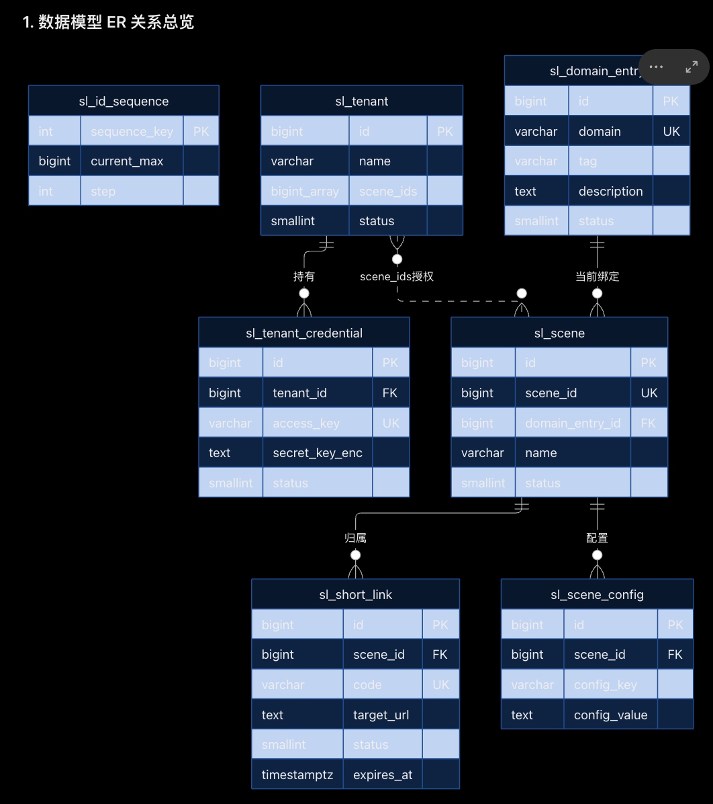
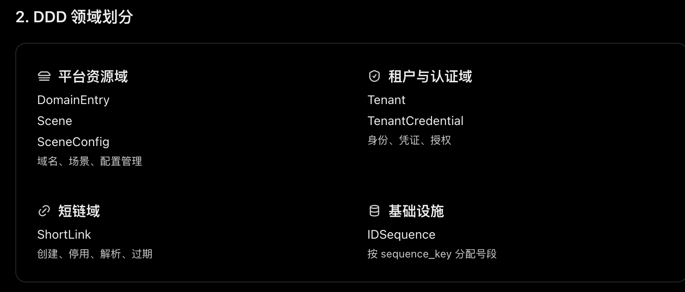

# Linklet v0.2 数据模型基线

实现补充：以 [v0.2 SDD](../openspec/changes/refactor-backend-v02/design.md) 冻结已有短链后的域名绑定；有未删除 Group 绑定时禁止域名下线。数据库增量迁移暂留旧列及 sl_link 兼容视图，清理属于后续 contract。升级步骤见 [迁移手册](v02-migration.md)。

PostgreSQL · OpenResty · DDD 领域建模 · 7 张表

根据我们刚才的讨论，重新整理为一份统一的数据模型基线。

本次最终采用：

- 短链表命名为 `sl_short_link`。
- 暂不增加 `link_type`，普通、永久短链统一存储。
- `expires_at IS NULL` 表示不过期。
- 带参短链属于解析策略，优先通过 GroupConfig 实现。
- Link 只关联 `group_id`，不保存 Tenant 和 DomainEntry。
- Tenant 通过 `group_ids` 授权使用、共同管理 Group 下的短链。
- 发号器使用数字枚举 `sequence_key`，直接作为主键，`1 = SHORT_LINK`。
- 保持七张表，不新增永久短链表。

## 1. 数据模型 ER 关系总览

```

erDiagram
    sl_domain_entry ||--o{ sl_group : "当前绑定"
    sl_group ||--o{ sl_group_config : "配置"
    sl_group ||--o{ sl_short_link : "归属"
    sl_tenant ||--o{ sl_tenant_credential : "持有"
    sl_tenant }o..o{ sl_group : "group_ids授权"

    sl_domain_entry {
        bigint id PK
        varchar domain UK
        varchar tag
        text description
        smallint status
    }

    sl_group {
        bigint id PK
        bigint group_id UK
        bigint domain_entry_id FK
        varchar name
        smallint status
    }

    sl_group_config {
        bigint id PK
        bigint group_id FK
        varchar config_key
        text config_value
    }

    sl_tenant {
        bigint id PK
        varchar name
        bigint_array group_ids
        smallint status
    }

    sl_tenant_credential {
        bigint id PK
        bigint tenant_id FK
        varchar access_key UK
        text secret_key_enc
        smallint status
    }

    sl_short_link {
        bigint id PK
        bigint group_id FK
        varchar code UK
        text target_url
        smallint status
        timestamptz expires_at
    }

    sl_id_sequence {
        int sequence_key PK
        bigint current_max
        int step
    }
```




Tenant 与 Group 是通过数组实现的逻辑授权关系，不存在实际外键；IDSequence 是独立基础设施，不参与 ER 外键关系。

### 关系说明

| 来源               | 目标          | 关系   | 数据库实现                |
| ---------------- | ----------- | ---- | -------------------- |
| Group            | DomainEntry | N:1  | `domain_entry_id`    |
| GroupConfig      | Group       | N:1  | `group_id`           |
| ShortLink        | Group       | N:1  | `group_id`           |
| TenantCredential | Tenant      | N:1  | `tenant_id`          |
| Tenant           | Group       | N:N  | `group_ids BIGINT[]` |
| ShortLink 创建     | IDSequence  | 能力依赖 | 无外键                  |

## 2. DDD 领域划分



平台资源域

DomainEntry

Group

GroupConfig

域名、分组、配置管理

租户与认证域

Tenant

TenantCredential

身份、凭证、授权

短链域

ShortLink

创建、停用、解析、过期

基础设施

IDSequence

按 sequence_key 分配号段

### 聚合边界

| 聚合根              | 管理的数据                        | 领域责任           |
| ---------------- | ---------------------------- | -------------- |
| DomainEntry      | `sl_domain_entry`            | 域名生命周期         |
| Group            | `sl_group`、`sl_group_config` | 分组配置、域名绑定      |
| Tenant           | `sl_tenant`                  | 租户状态、Group 授权  |
| TenantCredential | `sl_tenant_credential`       | AK/SK 生命周期     |
| ShortLink        | `sl_short_link`              | 短链生命周期         |
| IDSequence       | `sl_id_sequence`             | 基础设施发号，不作为业务聚合 |

设计原则：数据库存在外键，不代表 DDD 必须属于同一聚合。 跨聚合校验由应用用例协调，避免聚合之间相互持有、循环调用。

## 3. 数据模型相互边界

### 3.1 Tenant → Group：授权关系

Tenant 不拥有 Group，也不拥有 ShortLink。

```
Tenant A ─┐
          ├── Group 1001 ── ShortLink X
Tenant B ─┘             └── ShortLink Y
```

Tenant A、Tenant B 都被授权使用 Group 1001，因此都可以查询、停用其下的 ShortLink X 和 Y。

授权撤销只影响后续管理操作，不影响历史短链解析。

### 3.2 Group → DomainEntry：当前域名绑定

Group 管理当前使用哪个域名。

Group 仅在没有短链时可改绑域名；存在任何短链（含停用、到期）后绑定不可修改。ShortLink 为独立聚合。

### 3.3 ShortLink → Group：唯一业务归属

ShortLink 只保存 `group_id`。

它不关心租户身份、AK/SK、域名 ID、域名历史等信息。

Group 停用只阻止创建新短链，不自动停用已有短链。

### 3.4 ShortLink → IDSequence：基础设施调用

所有短链共享：

```
sequence_key = 1
```

通过数据库号段分配、Lua Worker 本地缓存、数字混淆和 Base62 编码生成全局唯一 Code。

发号器不保存 Group、Tenant 或 ShortLink 外键。

# 4. 七张表的定位、字段和索引

## 4.1 `sl_domain_entry` — 域名资源

职责： 管理平台域名及其投产、下线生命周期。

| 字段            | 类型           | 用途             |
| ------------- | ------------ | -------------- |
| `id`          | BIGSERIAL    | 内部主键           |
| `domain`      | VARCHAR(255) | 全局唯一域名         |
| `tag`         | VARCHAR(100) | 分类、搜索标签        |
| `description` | TEXT         | 说明             |
| `status`      | SMALLINT     | 1 新增、2 投产、3 下线 |
| `created_at`  | TIMESTAMPTZ  | 创建时间           |
| `updated_at`  | TIMESTAMPTZ  | 修改时间           |
| `enabled_at`  | TIMESTAMPTZ  | 投产时间           |
| `disabled_at` | TIMESTAMPTZ  | 下线时间           |
| `deleted_at`  | TIMESTAMPTZ  | 软删除时间          |

```
CREATE TABLE sl_domain_entry (
    id          BIGSERIAL PRIMARY KEY,
    domain      VARCHAR(255) NOT NULL UNIQUE,
    tag         VARCHAR(100),
    description TEXT,
    status      SMALLINT NOT NULL DEFAULT 1,
    created_at  TIMESTAMPTZ NOT NULL DEFAULT NOW(),
    updated_at  TIMESTAMPTZ NOT NULL DEFAULT NOW(),
    enabled_at  TIMESTAMPTZ,
    disabled_at TIMESTAMPTZ,
    deleted_at  TIMESTAMPTZ,

    CONSTRAINT chk_domain_status
        CHECK (status IN (1, 2, 3))
);
```

索引：`PRIMARY KEY(id)`、`UNIQUE(domain)`。

领域约束：投产后 `domain` 不可修改；状态只能新增 → 投产 → 下线，不可逆。

## 4.2 `sl_group` — 业务分组

职责： 组织短链、绑定域名、控制分组启停。

| 字段                | 类型           | 用途        |
| ----------------- | ------------ | --------- |
| `id`              | BIGSERIAL    | 内部主键      |
| `group_id`        | BIGINT       | 唯一业务分组编号  |
| `name`            | VARCHAR(255) | 分组名称      |
| `description`     | TEXT         | 说明        |
| `domain_entry_id` | BIGINT       | 当前域名      |
| `status`          | SMALLINT     | 1 启用、2 停用 |
| `created_at`      | TIMESTAMPTZ  | 创建时间      |
| `updated_at`      | TIMESTAMPTZ  | 修改时间      |
| `deleted_at`      | TIMESTAMPTZ  | 软删除时间     |

```
CREATE TABLE sl_group (
    id              BIGSERIAL PRIMARY KEY,
    group_id        BIGINT NOT NULL UNIQUE,
    name            VARCHAR(255) NOT NULL,
    description     TEXT,
    domain_entry_id BIGINT NOT NULL
                    REFERENCES sl_domain_entry(id),
    status          SMALLINT NOT NULL DEFAULT 1,
    created_at      TIMESTAMPTZ NOT NULL DEFAULT NOW(),
    updated_at      TIMESTAMPTZ NOT NULL DEFAULT NOW(),
    deleted_at      TIMESTAMPTZ,

    CONSTRAINT chk_group_id_uint32
        CHECK (group_id BETWEEN 1 AND 4294967295),

    CONSTRAINT chk_group_status
        CHECK (status IN (1, 2))
);

CREATE INDEX idx_sl_group_domain
    ON sl_group(domain_entry_id);
```

索引：`PRIMARY KEY(id)`、`UNIQUE(group_id)`、`INDEX(domain_entry_id)`。

领域约束：`group_id` 不可修改；仅无短链时允许改绑域名；停用不影响历史短链解析。

## 4.3 `sl_group_config` — 分组配置

职责： 为 Group 提供简单 KV 配置，包括后续参数透传策略。

| 字段             | 类型           | 用途   |
| -------------- | ------------ | ---- |
| `id`           | BIGSERIAL    | 内部主键 |
| `group_id`     | BIGINT       | 所属分组 |
| `config_key`   | VARCHAR(128) | 配置键  |
| `config_value` | TEXT         | 配置值  |
| `description`  | VARCHAR(255) | 配置说明 |
| `created_at`   | TIMESTAMPTZ  | 创建时间 |
| `updated_at`   | TIMESTAMPTZ  | 修改时间 |

```
CREATE TABLE sl_group_config (
    id           BIGSERIAL PRIMARY KEY,
    group_id     BIGINT NOT NULL
                 REFERENCES sl_group(group_id),
    config_key   VARCHAR(128) NOT NULL,
    config_value TEXT NOT NULL,
    description  VARCHAR(255),
    created_at   TIMESTAMPTZ NOT NULL DEFAULT NOW(),
    updated_at   TIMESTAMPTZ NOT NULL DEFAULT NOW(),

    CONSTRAINT uq_group_config
        UNIQUE (group_id, config_key)
);
```

索引：`PRIMARY KEY(id)`、`UNIQUE(group_id, config_key)`。

领域约束：配置可新增、修改、删除；缺失时使用应用默认值。

## 4.4 `sl_tenant` — 租户

职责： 租户身份、状态、Group 授权。

| 字段           | 类型           | 用途        |
| ------------ | ------------ | --------- |
| `id`         | BIGSERIAL    | 租户主键      |
| `name`       | VARCHAR(255) | 租户名称      |
| `group_ids`  | BIGINT[]     | 授权分组集合    |
| `status`     | SMALLINT     | 1 启用、2 停用 |
| `created_at` | TIMESTAMPTZ  | 创建时间      |
| `updated_at` | TIMESTAMPTZ  | 修改时间      |
| `deleted_at` | TIMESTAMPTZ  | 软删除时间     |

```
CREATE TABLE sl_tenant (
    id         BIGSERIAL PRIMARY KEY,
    name       VARCHAR(255) NOT NULL,
    group_ids  BIGINT[] NOT NULL DEFAULT '{}',
    status     SMALLINT NOT NULL DEFAULT 1,
    created_at TIMESTAMPTZ NOT NULL DEFAULT NOW(),
    updated_at TIMESTAMPTZ NOT NULL DEFAULT NOW(),
    deleted_at TIMESTAMPTZ,

    CONSTRAINT chk_tenant_status
        CHECK (status IN (1, 2))
);
```

索引：`PRIMARY KEY(id)`。

领域约束：`group_ids` 去重、验证 Group 存在；停用阻止管理 API，但不影响已有短链跳转。

## 4.5 `sl_tenant_credential` — 租户凭证

职责： AK/SK 认证与凭证生命周期。

| 字段               | 类型           | 用途        |
| ---------------- | ------------ | --------- |
| `id`             | BIGSERIAL    | 内部主键      |
| `tenant_id`      | BIGINT       | 所属租户      |
| `access_key`     | VARCHAR(128) | 唯一 AK     |
| `secret_key_enc` | TEXT         | 加密保存的 SK  |
| `description`    | VARCHAR(255) | 凭证说明      |
| `status`         | SMALLINT     | 1 启用、2 停用 |
| `created_at`     | TIMESTAMPTZ  | 创建时间      |
| `updated_at`     | TIMESTAMPTZ  | 修改时间      |
| `disabled_at`    | TIMESTAMPTZ  | 停用时间      |

```
CREATE TABLE sl_tenant_credential (
    id             BIGSERIAL PRIMARY KEY,
    tenant_id      BIGINT NOT NULL
                   REFERENCES sl_tenant(id),
    access_key     VARCHAR(128) NOT NULL UNIQUE,
    secret_key_enc TEXT NOT NULL,
    description    VARCHAR(255),
    status         SMALLINT NOT NULL DEFAULT 1,
    created_at     TIMESTAMPTZ NOT NULL DEFAULT NOW(),
    updated_at     TIMESTAMPTZ NOT NULL DEFAULT NOW(),
    disabled_at    TIMESTAMPTZ,

    CONSTRAINT chk_credential_status
        CHECK (status IN (1, 2))
);

CREATE INDEX idx_sl_credential_tenant
    ON sl_tenant_credential(tenant_id);
```

索引：`PRIMARY KEY(id)`、`UNIQUE(access_key)`、`INDEX(tenant_id)`。

领域约束：AK 不复用，SK 不原地修改；轮换通过新增凭证实现；停用不可恢复。

## 4.6 `sl_short_link` — 短链实体

职责： 统一承载普通、永久及未来带参短链。

| 字段            | 类型          | 用途              |
| ------------- | ----------- | --------------- |
| `id`          | BIGSERIAL   | 内部主键            |
| `group_id`    | BIGINT      | 唯一业务归属          |
| `code`        | VARCHAR(20) | 全局唯一短码          |
| `target_url`  | TEXT        | 不可修改的目标 URL     |
| `status`      | SMALLINT    | 1 启用、2 停用       |
| `created_at`  | TIMESTAMPTZ | 创建时间            |
| `expires_at`  | TIMESTAMPTZ | 到期时间，NULL 表示不过期 |
| `disabled_at` | TIMESTAMPTZ | 停用时间            |

```
CREATE TABLE sl_short_link (
    id         BIGSERIAL PRIMARY KEY,
    group_id   BIGINT NOT NULL
               REFERENCES sl_group(group_id),
    code       VARCHAR(20) NOT NULL UNIQUE,
    target_url TEXT NOT NULL,
    status     SMALLINT NOT NULL DEFAULT 1,
    created_at TIMESTAMPTZ NOT NULL DEFAULT NOW(),
    expires_at TIMESTAMPTZ,
    disabled_at TIMESTAMPTZ,

    CONSTRAINT chk_short_link_status
        CHECK (status IN (1, 2))
);

CREATE INDEX idx_sl_short_link_group
    ON sl_short_link(group_id);
```

索引：`PRIMARY KEY(id)`、`UNIQUE(code)`、`INDEX(group_id)`。

领域约束：

- Code、Group、target_url 不可修改。
- 停用不可恢复，Code 永久不复用。
- `expires_at IS NULL` 表示无时间到期限制。
- 不增加 `link_type`。
- 参数透传策略由 GroupConfig 控制。
- 不保存 Tenant、DomainEntry。

## 4.7 `sl_id_sequence` — 号段发号器

职责： 以数字枚举标识独立编号空间，按号段批量分配 ID。

| 字段             | 类型          | 用途      |
| -------------- | ----------- | ------- |
| `sequence_key` | INTEGER     | 主键，数字枚举 |
| `current_max`  | BIGINT      | 已分配最大编号 |
| `step`         | INTEGER     | 默认号段大小  |
| `created_at`   | TIMESTAMPTZ | 创建时间    |
| `updated_at`   | TIMESTAMPTZ | 修改时间    |

```
CREATE TABLE sl_id_sequence (
    sequence_key INTEGER PRIMARY KEY
        CHECK (sequence_key > 0),

    current_max BIGINT NOT NULL DEFAULT 0
        CHECK (current_max BETWEEN 0 AND 4294967295),

    step INTEGER NOT NULL DEFAULT 1000
        CHECK (step BETWEEN 1 AND 1000000),

    created_at TIMESTAMPTZ NOT NULL DEFAULT NOW(),
    updated_at TIMESTAMPTZ NOT NULL DEFAULT NOW()
);

-- 1 = SHORT_LINK
INSERT INTO sl_id_sequence
    (sequence_key, current_max, step)
VALUES
    (1, 0, 1000);
```

索引：`PRIMARY KEY(sequence_key)`，不需要其他索引。

领域约束：

- `sequence_key` 不可修改、删除、复用。
- `current_max` 只允许递增。
- `step` 可修改，影响后续号段申请。
- 全部 Group 共享短链发号空间。
- 支持 `next_id()`、`next_ids(count)`、`allocate_segment(size)`。
- PostgreSQL 原子分配，Worker 本地缓存，编号不回收。

## 5. 索引总览

| 表                      | 主键             | 唯一约束                     | 普通索引              |
| ---------------------- | -------------- | ------------------------ | ----------------- |
| `sl_domain_entry`      | `id`           | `domain`                 | —                 |
| `sl_group`             | `id`           | `group_id`               | `domain_entry_id` |
| `sl_group_config`      | `id`           | `(group_id, config_key)` | —                 |
| `sl_tenant`            | `id`           | —                        | —                 |
| `sl_tenant_credential` | `id`           | `access_key`             | `tenant_id`       |
| `sl_short_link`        | `id`           | `code`                   | `group_id`        |
| `sl_id_sequence`       | `sequence_key` | 主键本身                     | —                 |

## 6. 设计评审与未决边界

整体设计已比较收敛：三大业务领域、一个基础设施模块、七张表，短链实体只依赖 Group。

原始设计中以下两项由后续 v0.2 SDD 确定（生产切换仍需核对历史兼容清单）：

1. Gateway 要求 Host 等于 Group 当前绑定域名；缓存键包含 Host。已有短链后禁止改绑，已发 URL 的域名保持稳定。
2. 任一未删除 Group 当前绑定该域名时，禁止下线，采用与绑定操作共享的行锁保护。

此外，数据库中的 `CHECK`、`UNIQUE`、`FOREIGN KEY` 只能覆盖一部分不变量。不可逆状态、不可变字段、发号游标单调递增、`group_ids` 数组授权一致性，仍需通过 Repository、事务和必要的数据库保护实现。

最终基线：`sl_short_link` + `sl_id_sequence(sequence_key)`，七张表不变，暂无 `link_type`，Group 是短链唯一归属，Tenant 是授权主体。
