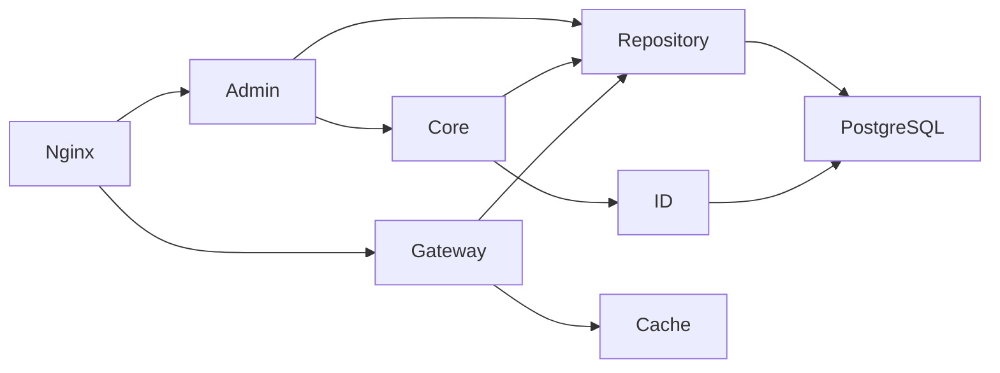

# Linklet v0.2 设计

设计依据为 [v0.2 SDD](../openspec/changes/refactor-backend-v02/design.md)，正式行为规范见 `openspec/specs/`。迁移与发布门槛见 [迁移手册](v02-migration.md)，文件映射和取舍见 [审计记录](v02-audit.md)。

所有模块在 lib/linklet；Core 不依赖 ngx、HTTP 或 SQL。Admin HTTP 适配调用 Core 创建用例，简单资源操作直接调用 Repository。Gateway 缓存命中后统一进入 Redirect，不经过 Admin。构造参数注入依赖，不引入框架或 Service 层。

七张表为 DomainEntry、Scene、SceneConfig、Tenant、TenantCredential、ShortLink、IDSequence。ShortLink 仅关联 scene_id；Tenant.scene_ids 为授权集合，多租户共同管理同 Scene 的链接。保留旧字段供迁移过渡，它们不再表示业务归属。

域名状态为 1新增→2投产→3下线；有未删除 Scene 绑定时禁止下线。Scene 绑定变更和域名下线持有同一域名行锁。链接和凭证停用为终态，code 永久不复用；场景业务 ID、目标 URL 和 SK 不原地修改。

Gateway 检查 Host 与当前域名、域名投产状态、链接状态和 expires_at，不因 Tenant/Scene 停用阻断历史短链。缓存键包含 Host+Code+generation，TTL 不超过有效期。持久 revision 轮询默认 0.5 秒，同步新鲜度窗口为 1 秒；超时绕过缓存，数据库失败返回 500。正在执行的旧请求可以完成。

所有 Scene 共享 sequence_key=1；数据库 step 为默认号段长度。next_id、next_ids 和 allocate_segment 分配不重叠，直接返回的号段不进入 Worker 池；32 位上限拒绝回绕，允许失败与重启产生空洞。
