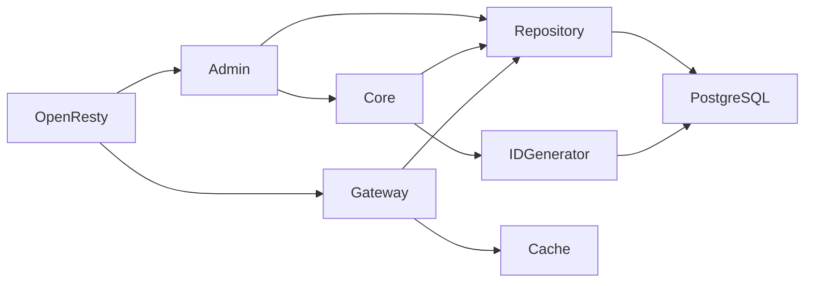

# Linklet v0.2 后端架构与数据模型改造方案

本文件保留改造动机与建议；落地映射见 [审计记录](v02-audit.md)，实际升级流程见 [迁移手册](v02-migration.md)。旧字段删除推迟至独立 contract 版本，当前不执行破坏性清理。

基于现有 GitHub 源码检查 · OpenResty / Lua · PostgreSQL · Core + Admin API + Gateway

我重新读取了 [fangfengxiang/linklet](https://github.com/fangfengxiang/linklet?utm_source=chatgpt.com) 的 README、初始化 SQL、应用入口、发号器、短链模型、Scene 模型、认证中间件及创建、解析处理器。

结论：Linklet 不需要推倒重写。现有项目已经具备核心能力，但代码仍建立在旧的“Tenant 拥有 Scene、Scene 拥有短链”模型上。新数据模型改变了授权和归属关系，因此这次改造的重点不是移动文件，而是修正领域边界。

我建议把这次升级定位为 Linklet v0.2：数据模型收敛 + Lua 模块重组 + Admin/Gateway 解耦。

## 一、现状评估

现有基础

# 可复用

缓存、发号、鉴权、路由、测试

核心问题

# 领域关系

Tenant / Scene 旧归属模型

改造策略

# 渐进迁移

先行为，再结构，最后清理

| 当前实现                              | 发现的问题                        | 改造方向                    | 优先级 |
| --------------------------------- | ---------------------------- | ----------------------- | --- |
| `src/app.lua`                     | 初始化、依赖组装、路由与运行入口集中           | 拆分启动与 Admin/Gateway 入口  | P1  |
| `src/models/link.lua`             | SQL 依赖 `scene.tenant_id`     | 改为 Scene 归属 + Tenant 授权 | P0  |
| `src/models/scene.lua`            | Scene 创建必须传 `tenant_id`      | 移除租户归属                  | P0  |
| `src/shorten/handler.lua`         | 创建和 gen 重复；按租户所有权校验          | 统一创建用例、改为 Scene 授权      | P0  |
| `src/shorten/resolve_handler.lua` | 解析依赖 Tenant/Scene 状态         | 只检查真正影响解析的规则            | P0  |
| `src/lib/id_generator.lua`        | 单例 `id=1`，未使用 `sequence_key` | 保留号段算法，更新存储契约           | P1  |
| `src/middleware/auth.lua`         | 已有 HMAC 认证，但授权需补充            | 认证与 Scene 授权分离          | P1  |
| `migrations/001_init.sql`         | 与最新七表模型不一致                   | 增量迁移                    | P0  |

当前 README 已明确项目有 AK/SK HMAC、AES-256-GCM、PostgreSQL 号段分配、Base62、缓存解析及 Test::Nginx 验收基础。以上能力应优先复用，而不是替换成新的框架。

## 二、推荐的最终目录

这次我建议在上一版基础上进一步收敛，保留 OpenResty 风格，同时避免 `core/` 变成所有业务代码的堆放目录。

```
linklet/
├── lib/
│   └── linklet/
│       ├── core/
│       │   ├── short_link.lua
│       │   ├── scene.lua
│       │   ├── domain_entry.lua
│       │   ├── tenant.lua
│       │   └── credential.lua
│       │
│       ├── admin/
│       │   ├── routes.lua
│       │   ├── auth.lua
│       │   └── handlers/
│       │       ├── short_link.lua
│       │       ├── scene.lua
│       │       ├── scene_config.lua
│       │       ├── domain_entry.lua
│       │       ├── tenant.lua
│       │       └── credential.lua
│       │
│       ├── gateway/
│       │   ├── handler.lua
│       │   ├── resolver.lua
│       │   └── redirect.lua
│       │
│       ├── repository/
│       │   ├── short_link.lua
│       │   ├── scene.lua
│       │   ├── scene_config.lua
│       │   ├── domain_entry.lua
│       │   ├── tenant.lua
│       │   └── credential.lua
│       │
│       ├── db/
│       │   └── postgres.lua
│       │
│       ├── cache/
│       │   ├── local.lua
│       │   └── sync.lua
│       │
│       ├── id/
│       │   ├── generator.lua
│       │   └── obfuscator.lua
│       │
│       ├── http/
│       │   ├── request.lua
│       │   └── response.lua
│       │
│       └── app.lua
│
├── conf/
│   ├── nginx.conf
│   └── locations/
│
├── migrations/
│   ├── 001_init.sql
│   └── 002_domain_refactor.sql
│
├── spec/
│   ├── core/
│   ├── repository/
│   ├── admin/
│   ├── gateway/
│   └── id/
│
├── test/
│   ├── nginx/
│   └── benchmark/
│
├── api/
│   └── openapi.yaml
│
├── deploy/
├── docs/
├── openspec/
├── AGENTS.md
├── Makefile
├── Dockerfile
└── README.md
```

这份结构有三个关键取舍。

第一，保留 `repository/`，但不再增加 `models/` 作为另一层数据库访问抽象。 当前 `models/link.lua` 等文件本质上执行 SQL，迁移后直接成为 Repository。不要为了 DDD 再创建一套几乎相同的 Model。

第二，`core/` 只负责领域规则和必要的业务编排。 不应该放 HTTP 请求、`ngx.redirect`、SQL 字符串或 PostgreSQL 连接。简单 CRUD 可以由 Admin Handler 调用 Repository，不必每个动作都经过一层 Service。

第三，保留现有 `spec/`、`test/nginx/`、`deploy/`、`openspec/` 等目录。 它们已经是项目工程化资产，没必要为了统一风格而重命名。

## 三、核心模块依赖架构



这是允许的依赖方向，不表示每次请求都必须经过图中所有节点。

例如 Gateway 缓存命中后可以直接应用解析规则并返回结果，不需要查询数据库。

### Core 是否还需要进一步细分？

目前不需要。

可以先让 `core/short_link.lua` 提供创建、停用和有效性判断等领域能力，`core/scene.lua` 提供场景状态与授权相关规则。

但不要把 Core 写成大型 Service 框架。依赖通过构造参数显式传入即可，Context 只承载请求信息。

## 四、七张表的改造清单

这是整个升级中最重要的部分。

| 表                      | 现状与目标差异                            | 必须修改                                 |
| ---------------------- | ---------------------------------- | ------------------------------------ |
| `sl_domain_entry`      | 旧表有 `tenant_id`、`label`；新表平台共享     | 删除租户归属，`label` 改 `tag`，调整状态          |
| `sl_scene`             | 旧表 `scene_id` 是主键且有 `tenant_id`    | 新增内部 `id`，`scene_id` 唯一，删除租户归属       |
| `sl_scene_config`      | 缺 `description`、`updated_at`，配置值可空 | 补字段和约束                               |
| `sl_tenant`            | `scene_ids` 可空，缺 `deleted_at`      | 非空数组默认值，补软删除                         |
| `sl_tenant_credential` | 缺 `description`、`disabled_at`      | 补生命周期字段                              |
| `sl_link`              | 旧表名，缺 `disabled_at`                | 改名 `sl_short_link`，补字段               |
| `sl_id_sequence`       | 单例 `id=1`，没有 `step`                | 改为 `sequence_key` 主键，增加 `step` 和时间字段 |

特别提醒：不要直接覆盖已有数据库中的 `001_init.sql` 来完成升级。

建议区分两种情况：

- 新部署：可以在整理后使用完整的新基线 Schema。
- 已有部署：通过版本化增量迁移，保留旧数据、短码及发号器状态。

对于 `sl_scene`，迁移时保留已有 `scene_id` 数值，新增 `id` 作为内部主键；否则会破坏 ShortLink 和 SceneConfig 的关联。

对于 `sl_id_sequence`，必须将旧的 `current_max` 原样迁移到 `sequence_key=1`，不能重新从零开始，否则存在短码重复风险。

## 五、最重要的五项业务逻辑改造

### 1. 租户授权从“所有权”改为“授权集合”

当前代码中有：

```
if scene.tenant_id ~= ctx.tenant_id then
    return ctx.response:error_response(
        4004, "scene does not belong to tenant", 403
    )
end
```

这个判断必须删除。

改为：

```
local allowed = tenant:allows_scene(scene_id)

if not allowed then
    return nil, "scene access denied"
end
```

这里 `allows_scene` 是建议新增的领域方法，并非仓库现有 API。

数据库层面可利用 PostgreSQL 数组查询：

```
SELECT 1
FROM sl_tenant
WHERE id = $1
  AND status = 1
  AND deleted_at IS NULL
  AND $2::BIGINT = ANY(scene_ids);
```

这样 Tenant A 和 Tenant B 可以同时管理同一个 Scene 下的短链。

停用短链时也必须重新验证 Scene 授权，不能只在创建时校验。

### 2. 解析逻辑移除 Tenant/Scene 状态依赖

现有 `src/shorten/resolve_handler.lua` 会检查：

```
link.scene_status
link.tenant_status
link.domain_status
```

新规则中：

- Tenant 停用，不影响已有短链。
- Scene 停用，不影响已有短链。
- ShortLink 停用或过期，不能跳转。
- DomainEntry 下线，不能继续通过该域名提供跳转。

因此需要重写 `find_by_code()` 的查询与 Resolver 的有效性判断，避免旧逻辑导致大量历史短链失效。

域名校验与 Host 匹配规则仍需单独确定。

### 3. 统一 Create 与 Gen

现有 `src/shorten/handler.lua` 中，`create()` 和 `gen()` 都分别完成：

- 查询 Scene
- 校验归属
- 申请 ID
- 生成 Code
- 插入数据库

存在明显重复。

建议只保留一个创建用例：

```
local link, err = short_link:create({
    scene_id = scene_id,
    target_url = target_url,
    expires_at = expires_at,
})
```

`gen` 只负责在创建结果基础上生成完整 URL，不再重复执行创建逻辑。

### 4. 发号器保留算法，调整 API

现有 `src/lib/id_generator.lua` 已经实现：

- PostgreSQL 原子号段分配
- Worker 本地号段消费
- 并发信号量保护
- 号段耗尽检查

这些值得保留。

主要修改：

```
local generator = IdGenerator.new({
    db = db,
    sequence_key = 1,
})
```

数据库操作改为：

```
UPDATE sl_id_sequence
SET current_max = current_max + $2,
    updated_at = NOW()
WHERE sequence_key = $1
  AND current_max <= 4294967295 - $2
RETURNING current_max - $2 + 1 AS segment_start,
          current_max AS segment_end;
```

`step` 从数据库读取作为默认号段大小，显式传入的 `size` 可以覆盖默认值。

此外需要补充：

- `next_ids(count)`
- `allocate_segment(size)`
- 号段分配并发测试
- 数字边界与耗尽测试

尤其要保证 `allocate_segment()` 直接返回的号段不会再次进入 Worker 本地池。

### 5. 域名下线规则

你已经确定：

只要有 Scene 当前绑定某个 DomainEntry，就不允许下线。

因此 DomainEntry 下线用例应先检查：

```
SELECT EXISTS (
    SELECT 1
    FROM sl_scene
    WHERE domain_entry_id = $1
) AS is_bound;
```

前端展示下线是否允许，后端必须做最终校验。

并发场景还需要事务保护，避免检查通过后，另一请求又将 Scene 绑定到该域名。

## 六、现有文件迁移映射

下面是已检查源码对应的主要迁移目标。

| 旧文件                               | 新文件                                         | 处理方式          |
| --------------------------------- | ------------------------------------------- | ------------- |
| `src/app.lua`                     | `lib/linklet/app.lua`                       | 拆分初始化职责       |
| `src/models/link.lua`             | `lib/linklet/repository/short_link.lua`     | 重写关键 SQL      |
| `src/models/scene.lua`            | `lib/linklet/repository/scene.lua`          | 重写归属逻辑        |
| `src/lib/id_generator.lua`        | `lib/linklet/id/generator.lua`              | 保留算法，更新接口     |
| `src/shorten/handler.lua`         | `lib/linklet/admin/handlers/short_link.lua` | 精简为 HTTP 适配   |
| `src/shorten/resolve_handler.lua` | `lib/linklet/gateway/resolver.lua`          | 修正解析规则        |
| `src/middleware/auth.lua`         | `lib/linklet/admin/auth.lua`                | 保留签名能力，完善状态检查 |

未逐一读取的文件，例如缓存同步、其余 Admin Handler、路由及测试，应在实际修改前再次检查，不建议仅根据文件名直接批量搬迁。

## 七、建议按六个阶段实施

阶段 1：建立改造基线

盘点完整源码、依赖、现有测试、数据库迁移及部署配置。新增 `AGENTS.md`，明确目录和领域规则。先运行现有测试，记录基线结果。

阶段 2：数据模型迁移

完成七张表的增量迁移，验证历史数据、外键、索引、序列值与迁移回滚策略。尤其注意 Scene 归属改变带来的授权数据迁移。

阶段 3：Core 与 Repository

重写 ShortLink、Scene、Tenant 的关键数据访问与规则；更新 ID Generator。先完成不依赖 HTTP 的单元和数据库集成测试。

阶段 4：Admin API 与 Gateway

重构 Handler、认证授权、创建与解析流程。保留原有 API 路径的兼容性，必要变更通过版本化接口处理。

阶段 5：目录迁移与工程化

将稳定后的模块迁移至 `lib/linklet/`，更新 `lua_package_path`、Nginx 配置、Docker、测试加载路径、文档和 CI。

阶段 6：验收与发布

运行 Busted、Test::Nginx、PostgreSQL 集成测试和关键并发测试，验证缓存失效、授权、永久短链及迁移兼容性。

## 八、需要特别注意的风险

我认为这次改造有三个比目录重组更重要的风险。

第一，旧数据的授权语义迁移。 旧版 Scene 有 `tenant_id`，新版改为多个 Tenant 的 `scene_ids`。迁移必须将旧归属转换为授权集合，不能简单删除 `tenant_id`，否则原租户可能丢失管理权限。

第二，缓存一致性。 目前项目有缓存同步机制。新版 Scene 改绑域名、DomainEntry 状态变更、ShortLink 停用时，都需要确认相关缓存是否失效。尤其多 Worker、多实例部署时，不能只清除当前 Worker 的缓存。

第三，Admin Web 的登录模型。 当前后端主要是 AK/SK HMAC 认证，它适合程序调用，不适合直接把 Secret Key 长期放在浏览器中。独立的 React 管理后台需要安全的浏览器会话认证方案。这个问题建议单独设计，不能简单复用 AK/SK 并暴露 SK 给前端。

## 九、改造完成的验收标准

| 验收项   | 预期结果                      |
| ----- | ------------------------- |
| 数据模型  | 七张表与最新约束一致                |
| 目录    | Lua 模块统一位于 `lib/linklet/` |
| 创建短链  | 按 Tenant 的 Scene 授权校验     |
| 共享管理  | 两个被授权租户可以管理同一 Scene 的短链   |
| 解析    | Tenant/Scene 停用不影响已有有效短链  |
| 永久短链  | `expires_at=NULL` 可以正常解析  |
| 域名下线  | 有 Scene 绑定时禁止下线           |
| ID 分配 | 多 Worker 不重复，保留历史发号状态     |
| 缓存    | 停用、配置变更后不会持续返回失效数据        |
| 兼容性   | 原有 API 与短码尽可能保持兼容         |
| 测试    | 单元、数据库、OpenResty 端到端测试通过  |

## 最终建议

这次改造应该遵循一个原则：

保留 Linklet 已经实现的成熟基础设施，重写发生领域语义变化的部分，最后再整理目录。

不引入新的 DI 容器、不引入额外的 Service 层、不把 Core 拆成独立仓库，也不为了“架构纯粹”牺牲 Gateway 的缓存解析性能。

我建议把这份方案作为 Linklet v0.2 重构规格，交给 Codex 分阶段实施，而不是一次性让它重写整个仓库。

其中，最先落地的应该是 七张表迁移 + Scene 授权模型调整。这是后续所有 Admin API、Gateway 和 React 管理后台开发的共同基础。